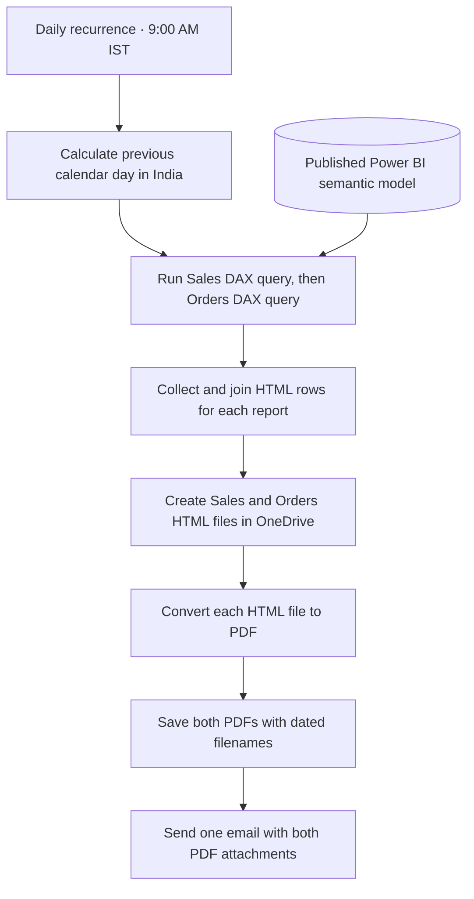

# Daily Sales and Order Reporting with Power BI and Power Automate

Every morning at 9:00 AM India Standard Time, a scheduled cloud flow prepares two PDFs and sends them together in one email. **Sales Overview** and **Orders Overview** use the previous calendar day as their reporting date. The recipient can read the headline KPIs and every product-group row directly from the attachments.

## The real-world problem

Management wanted the two pages of an existing Power BI report delivered by email. A screenshot looked like a straightforward solution until I tried to capture the product-group matrix. The dashboard showed a total for the entire table, but the screenshot showed only the handful of rows visible above the scrollbar. A director reading the email could see the total without being able to inspect all the groups behind it.

The interactive report also used a switch between month-to-date (MTD) and year-to-date (YTD) order fulfilment. A static attachment could show only the selected view. The daily email needed to answer both questions in one reading.

## How I solved it

I wrote one DAX query for each report page. Each query calls the existing measures in the published Power BI semantic model and returns the rows needed to reproduce its KPIs and tables. This kept the flow manageable as the number of visuals grew. It also let each table expand to fit its data.

I built a separate HTML document for each overview and used OneDrive for Business to convert each document to PDF. The documents use left-aligned values, bold section headings, and distinct total rows. The Orders PDF repeats the fulfilment table with two explicit filter contexts, MTD first and YTD immediately below. Readers can compare the same columns across both periods.

## Flow diagram

The flow processes Sales and Orders sequentially within each stage. Both files must reach the final save step before the email action runs.



## What each PDF contains

| Sales Overview | Orders Overview |
| --- | --- |
| Yesterday Sales, MTD Sales, YTD Sales, and MTD quantity | Blanket orders booked MTD and YTD, planned orders, and orders due for dispatch |
| Sales and quantity by business vertical | Blanket order value by business vertical |
| Warranty and non-warranty sales by period | MTD and YTD fulfilment by vertical, including on-time delivery in full, partial dispatch, and five delay ranges |
| Sales, unit price, pieces, quantity and ratios by product group | Booked, pending and overdue quantities by product group |

## How the dates work

For a run on **23 November 2026**, the dashboard's **As On Date** is **22 November 2026**. The report's original Yesterday, MTD and YTD measures keep their dashboard definitions. The previous-day filter supplies the context in which they are evaluated. The queries use data available in the semantic model at run time, so the model's scheduled refresh matters if late postings arrive.

The flow calculates the date used in the email and filenames with this Compose expression:

```text
formatDateTime(addDays(convertTimeZone(utcNow(),'UTC','India Standard Time'),-1),'yyyy-MM-dd')
```

The two DAX queries independently calculate the previous calendar day in IST. For the scheduled morning run, both use the same reporting day. An example of the resulting filenames is:

```text
Daily Sales Overview - 22 November 2026.pdf
Daily Orders Overview - 22 November 2026.pdf
```

## Implementation details

1. **Retrieve the data.** Two Power BI “Run a query against a dataset” actions evaluate the page measures. The DAX output includes a section sequence, a total-row indicator, a row label and an HTML fragment. The final sort puts each section in report order and its total after the detail rows.
2. **Assemble the documents.** Select actions collect the HTML fragments from each query. Compose actions join the fragments in order so each overview has its own document header, tables and closing tags.
3. **Create the attachments.** OneDrive creates each HTML file, converts it to PDF and saves the result. The final email action uses the saved filename and the corresponding conversion's binary file content for each attachment.
4. **Deliver the reports.** The scheduled flow sends one short email with the reporting date in the subject and body. The published model and cloud connectors handle the morning run without a desktop session.

## What I tested and learned

- **Report accuracy.** I compared the results with the refreshed dashboard for the same As On Date. Using the same refresh was important because bookings could change between refreshes.
- **Scheduled delivery.** Emails arrived at 9:00 AM on consecutive days. The 22 November email referenced 21 November, and the 23 November email referenced 22 November.
- **The recipient's view.** Opening the emails revealed an issue the successful flow runs had missed. The subject and PDF figures advanced correctly while attachment names still contained a fixed date. The correction was to use the reporting-date expression in the file names and use each saved PDF's Name output in the email.

## What this project demonstrates

I used **Power BI, DAX, Power Automate, HTML/CSS and OneDrive for Business** to turn an interactive dashboard into a daily management report. The practical outcome was a director being able to read the complete product breakdown and both fulfilment periods from a single morning email.

This public case study documents the implementation. Reproducing it in another environment requires a semantic model with the corresponding measures, authorised connector accounts, an output folder, and a recipient. The production solution and client data are private.
